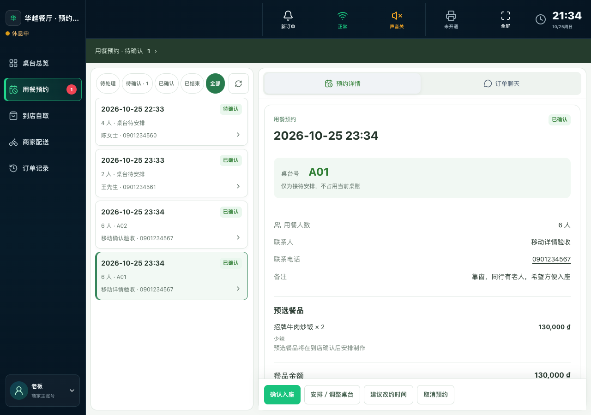
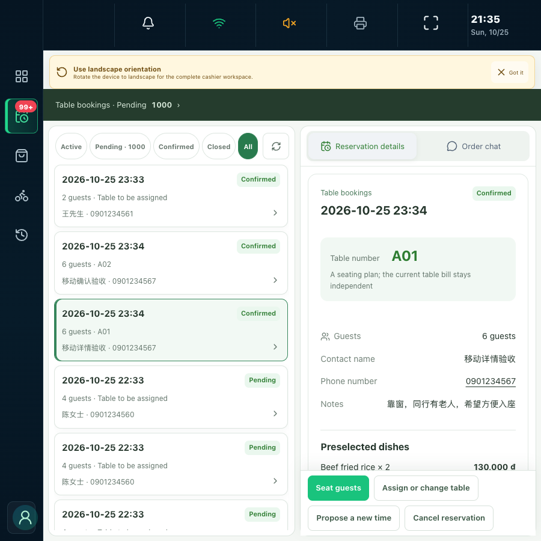
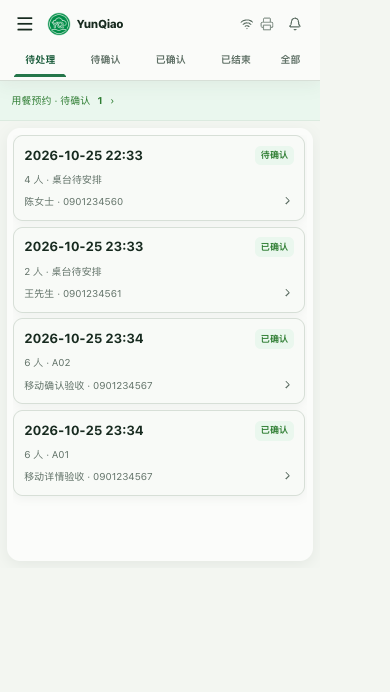

# 用餐预约筛选与刷新同排

2026-10-25，本地验收完成，用户已明确授权提交、推送和上线。候选版本 `reservation-single-row-20261025-v1`，实际发布结果见 [发布记录](../../release/reservation-single-row-20261025-v1.md)。

保留待处理、待确认、已确认、已结束、全部五项状态和电脑刷新按钮，未减少状态或待确认数量。桌面预约队列根据工具栏内容决定最小宽度，按钮收紧左右留白，保持原字体和 44px 点击高度；状态与刷新同排，无横滑、截字或重叠。样式仅作用于桌面用餐预约，不影响自取、配送或手机现行外壳。手机继续使用已有的单行五状态和无刷新布局。

验证通过：

- 收银 101 个测试文件、817 项测试；类型检查、生产构建、lint。
- 隔离本地 API 5 项流程：冷启动、配送菜单进入预约、确认并安排桌号、聊天和返回、加载／空／失败状态等。
- 手机 9 组，中英越，320–899px；检查列表、详情、聊天及五项筛选单行、无截字、无横滑。
- 电脑 18 组：900／1024／1280／1440／1920px × 中英越，另各语言在 900px 模拟待确认 1000 条。验证五项筛选和刷新中心线一致、完整可见、无重叠，页面无横向溢出，浏览器错误 0。大数量仅在浏览器替换响应，不写入 API。

执行脚本：`apps/merchant-cashier/scripts/verify-reservation-mobile-v2.mjs`。结构化结果见 [REPORT.json](REPORT.json)。全部业务操作仅使用受守卫约束的本地测试库，无生产业务写入。

