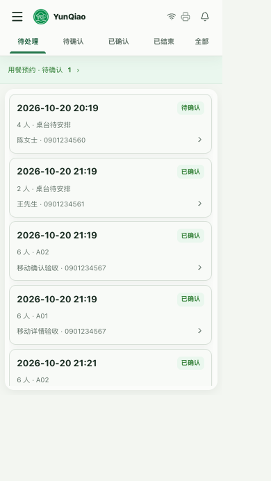
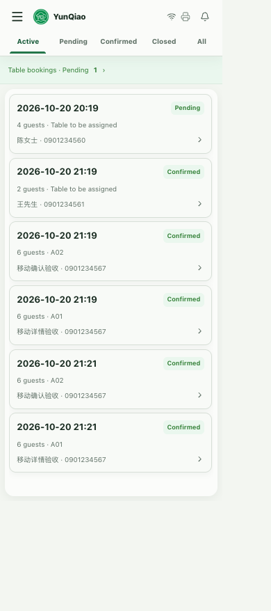
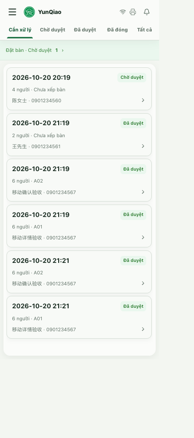
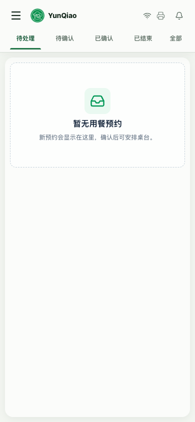
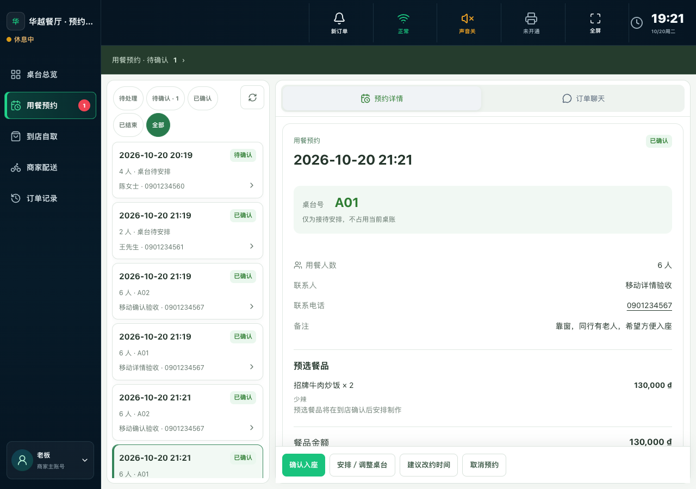

# 收银用餐预约文案与筛选精简

开发与本地验收：2026-10-20。状态：2026-10-21 已按用户授权提交、推送 GitHub main 并上线，版本 `reservation-toolbar-20261021-v1`，代码 `348ee733a3a12e16fa4009a39da677444d6b4c2e`。详见 [发布记录](../../release/reservation-toolbar-20261021-v1.md)。

## 页面结果

- 商家导航、预约详情、提醒及通知设置使用“用餐预约”；越南语 Đặt bàn、英语 Table bookings。
- 状态为待处理／待确认／已确认／已结束／全部，待确认、已确认的卡片状态使用一致的商家措辞。
- 电脑与手机删除列表日期、电话筛选、“以上均为越南时间”，并清除对应筛选逻辑和无用样式。顾客电话、实际预约时间及改约操作保留；实际时间转换不变。
- 手机五项筛选完整放在一行，不横滑、不截字；删除手机刷新按钮。电脑保留刷新，窄列表自动换行，五项筛选均可直接看到。
- 仅修改收银前端，不涉及 API、数据库、商家后台、KDS 或小程序。确认、安排桌号、入座、聊天及自取通道保持原逻辑。

## 验证

- 收银 97 个测试文件、722 项测试通过。
- 收银类型检查（生产构建包含 vue-tsc）、生产构建、lint 通过。
- 真实源码界面连接受守卫约束的本地 API、隔离测试库；5 项业务流程、9 组手机布局、9 组电脑布局通过，页面异常 0。
- 手机：320×568 中文，320×720 越南语／英语，375×667 越南语，390×844 英语，414×896 越南语，430×932 中文，768×1024 越南语，899×800 英语；每组检查列表、详情、聊天。另验证真实移动视口、冷启动、加载／空／失败状态。
- 手机每组检查五个状态处于同一行、无横向滚动／文本截断，实际点击待确认／已确认后卡片状态与筛选文案一致。
- 电脑：900／1280／1440 × 中英越；五个筛选均完整可见，刷新保留，日期／电话筛选及时间提示均不存在。
- 流程：配送菜单进入预约 → 确认预约并安排桌号 → 发送真实本地聊天 → 返回列表／选择其他预约；深链及独立预览使用同一现行外壳。
- 设计扫描 P0=0；P2 是已有白色／颜色字面量及局部组件无独立构建标记，本次沿用现行外壳，不更换配色或引入新素材。

执行脚本：`apps/merchant-cashier/scripts/verify-reservation-mobile-v2.mjs`。完整结构化结果见 [REPORT.json](REPORT.json)。截图使用本地测试顾客、桌号和餐品，不连接生产账号或创建生产业务数据。

发布验收：[服务器](DEPLOYMENT_PASS.json)、[外网资源](PUBLIC_PASS.json)、[手机／电脑浏览器入口](BROWSER_PASS.json) 均 PASS。服务器与外网各校验 68 文件；390／1366 登录入口无页面错误或横向溢出。受保护页面内的业务流程与布局由上面的隔离本地 API 检查覆盖，未使用生产账号代为确认预约或发送消息。

## 截图

